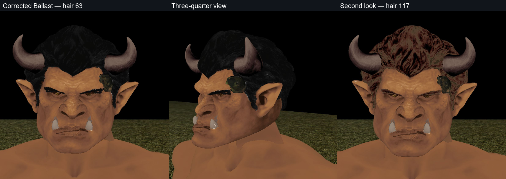

# Ballast brow and ear correction
Ballast remains pmg0_head019. Shade stretching amplified a soft brow fringe and baked ear highlights into pale outlines even though ownership was correct.
Headbatch face-v1 now enables palette.repairFeatureHighlights automatically. Brow repair uses nearby same-channel surface samples before the existing automatic game-size contrast search. Excessive ear highlights receive a continuous shoulder relative to plain face skin after seam repair. Authored skin masks, ownership and other materials remain protected. Eligible shades and corrected chart gutters are checked before shade-span statistics and the independent quality gate.
The saved approved palette/tone/UV checkpoint was replayed through this maintained quantizer. The final replay produced identical PLT bytes. The mesh and all 125 other pack resources are byte-identical; only Ballast's PLT changed. The existing contrast search chose 0.9 to retain feature clarity after removing the artificial white edge.
The rebuilt 126-resource srn_head HAK was checked in NWN:EE, loaded above srn_body with Ballast from the base HAK. Front, all four three-quarter views, gameplay distance and hair rows 63/117 were visually checked. Brows recolor with hair; the white brow fringe is removed and ear highlights are substantially reduced. Small pre-existing bright flecks in the back hair remain. Motion, equipment, multiplayer and server deployment were not repeated.

[Portable hashes and measurements](ballast-edge-correction-v1.json) record the original checkpoint hashes, unchanged geometry, final texture, quality metrics and loaded HAK. Historical reindex records remain unchanged. This revision is local and has not been pushed or deployed.
Validation: 953 broad headkit/headbatch/head checks passed; the broad runner's single transport-module import error was resolved by adding the repository root to its path and rerunning that module. The final affected suite passed 48 tests, and all seven final feature-highlight regressions passed. The independent PLT quality gate, exact HAK payload check and client slot/row verification also passed.
