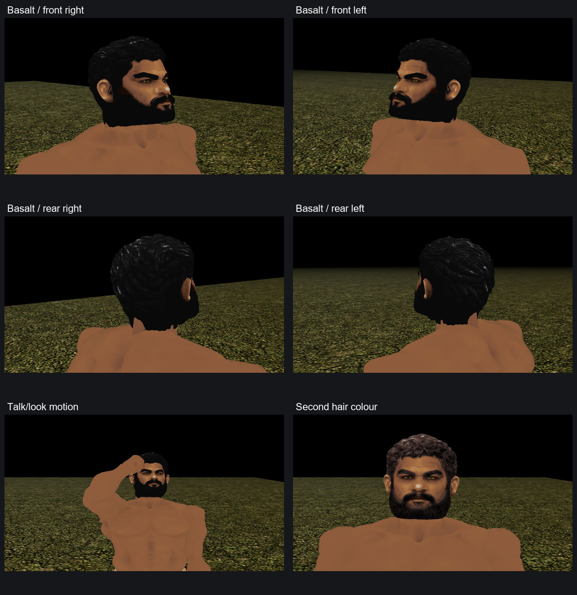
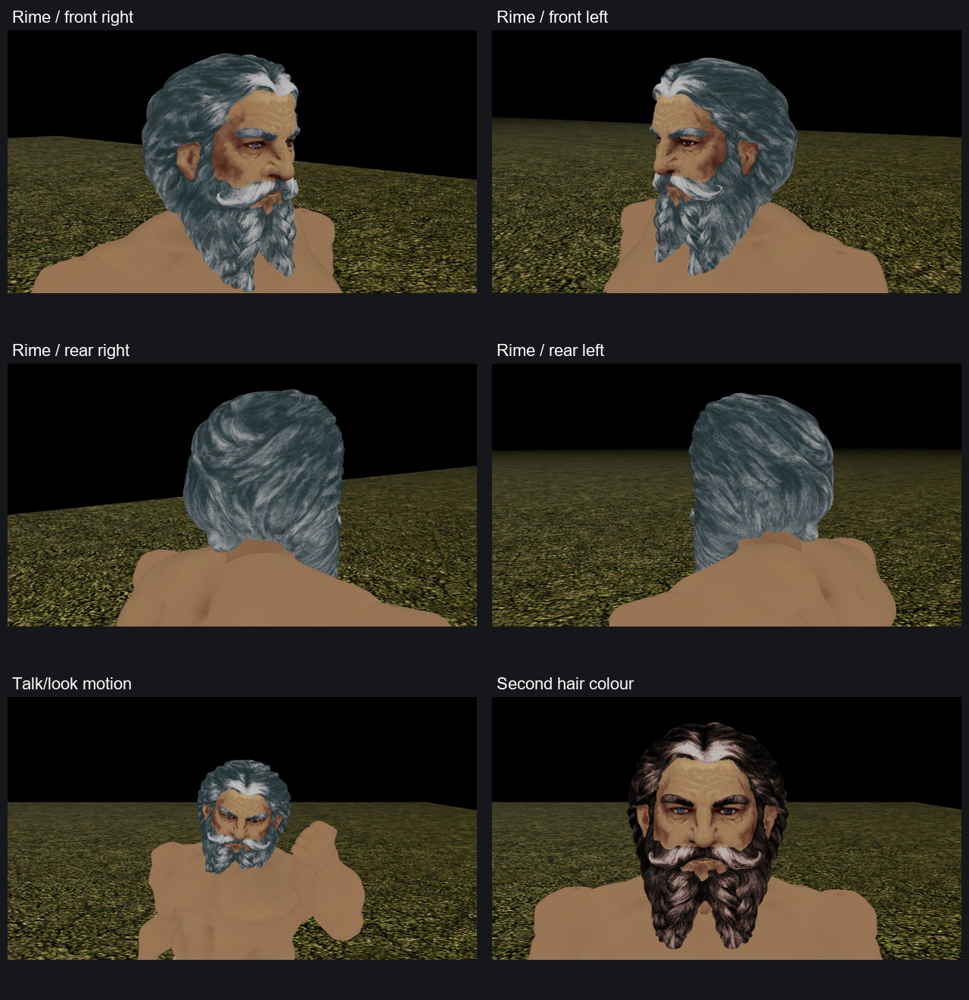
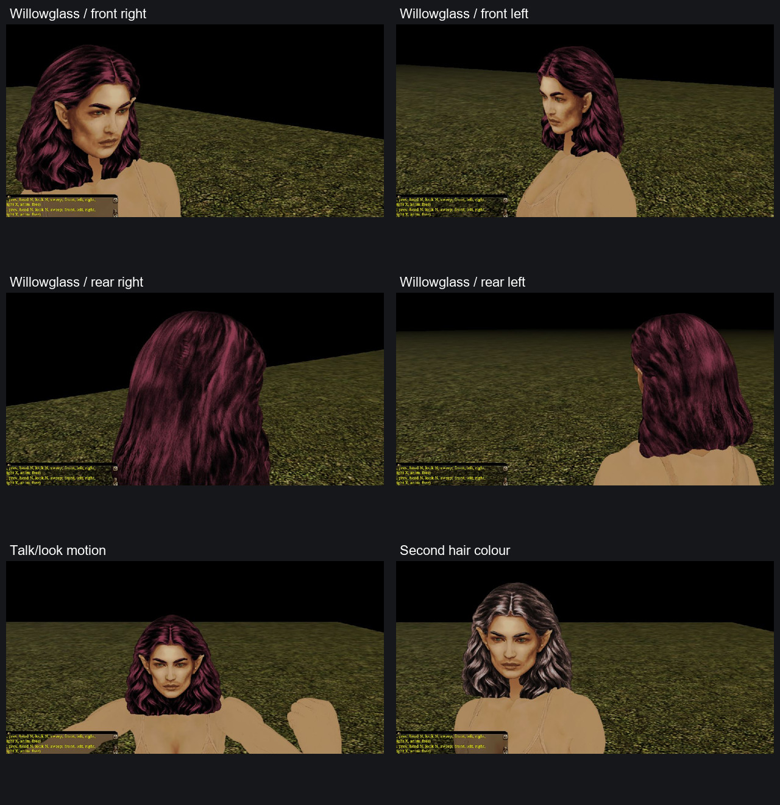

# Basalt, Rime and Willowglass

This adds three client-reviewed native heads to srn_head:

| Name | Slot/model | Visual style | Skin / hair / iris rows |
| --- | --- | --- | --- |
| Basalt | pmd0_head021 | Short black curls, square black beard and broad adult Dwarf face. | 3 / 63 / 115 |
| Rime | pmd0_head022 | Silver swept hair, curled moustache and two long beard braids. | 117 / 19 / 132 |
| Willowglass | pfe0_head021 | Long aubergine hair, exposed pointed ears and tapered adult Elf face. | 156 / 99 / 113 |

Each head is a rigid 20,000-triangle MDL with a 1024×1024 PLT. These are the exact
native bytes reviewed in the private NWN:EE client; publication does not rerun
generation, fitting or texture conversion. Basalt and Rime use the built-in
oldm_head organic material; Willowglass uses oldf_head. The installed stock
material payloads were checked in the trials and are not redistributed.

The user selected all three designs and delegated operator reviews through
the client. The operator checked four neutral three-quarter views, talk/look
motion and a second hair colour, and verified the logged slots and colours.
Basalt's review explicitly combines two pinned partial capture sessions; the
other heads have one complete final capture record each. Operator approval is
recorded separately from user visual approval. The user authorized these asset
and tooling PRs after the completed client review.

Willowglass preserves the user's selected fit06 pose and uniform scale. Her
rear-temple hair opening is closed; all 516,401 previously mapped palette
texels, including 94,002 skin texels, retain their approved channel, shade and
decoded colour. This correction changes only the local hair geometry/charts.
The native readback preserves fit, positions, normals, UVs and resource identity.

The [portable manifest](dwarf-elf-head-trio-v1.json) contains resource hashes,
selected design hashes, actual submission/attempt counters, quality results and
client-evidence hashes. Local paths, tool bindings, generated intermediates,
private logs and HAK builds remain outside the repository. The separate
headkit PR makes the improvements reusable; these native resources load without
that PR.

## In-game evidence

These galleries crop and reduce the original client frames for readability;
the textures and geometry are not edited in the galleries. Each includes four
angles, a motion frame and the second hair colour.

Basalt's black hair row suppresses fine beard relief; the alternate brown look
shows more of the texture. Angular hair/beard edges remain appropriate to the
engine. Helmet combinations, every palette row, the full animation catalogue,
extended gameplay and multiplayer were not checked. The three heads were
checked in isolated trial HAKs; the combined production pack has not had a
separate client session.

Load srn_head above srn_body and use normal male Dwarf slots 21/22 or female Elf
slot21. All 130 existing resources remain byte-identical. No bodies, tables,
pack registration or existing head slots change. This is a publication PR
candidate, not a server deployment.

Validation: repository static validation passed. Rebuilt and reopened srn_head;
all 136 resource payload hashes match their source files exactly, including
the six additions. All 130 original resource hashes remain unchanged. No
other HAKs or TLK were rebuilt.
