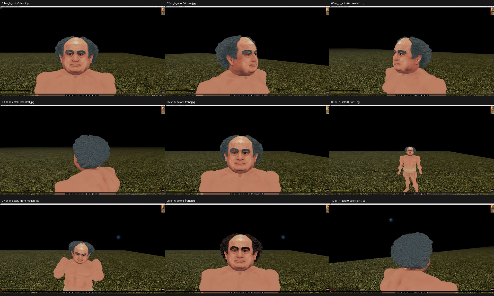
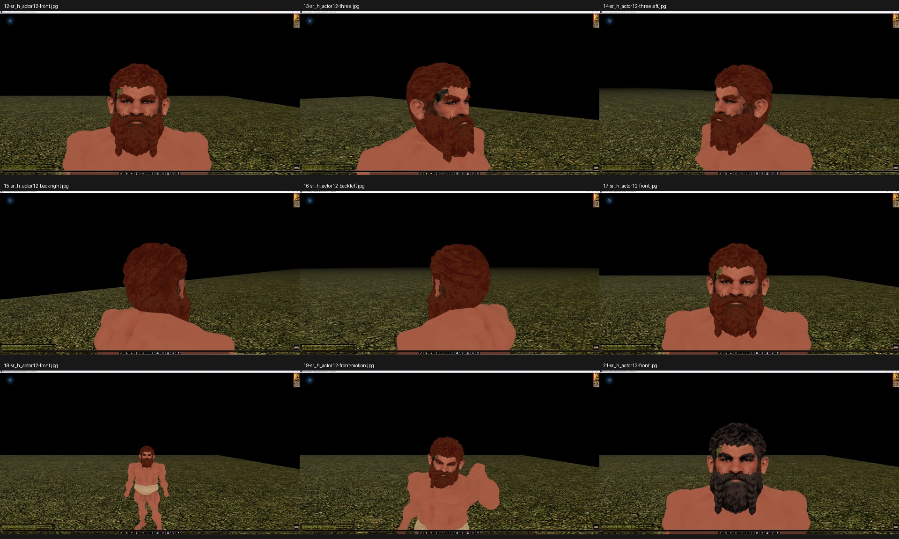

# Two approved male Dwarf heads

This adds two male Dwarf options to the existing srn_head pack:

| Slot | Model | Appearance | Chosen palette rows (skin / hair / iris) |
| --- | --- | --- | --- |
| 19 | pmd0_head019 | DeVito-like older Dwarf, receding curly hair and strong brows | 12 / 19 / 115 |
| 20 | pmd0_head020 | Copper-bearded Dwarf with muted blue-gray eyes | 13 / 5 / 23 |

Both use 20,000-triangle rigid head meshes and 1K PLT textures. The resources are
the exact MDL and PLT bytes checked in the private NWN:EE client trials.
Headkit native readback verified positions, normals, UVs and texture identity.
The client log verified the assigned slots and material rows; the operator
separately reviewed front, all four three-quarter views, gameplay distance,
talk/look motion and a contrasting second hair row.

The final DeVito correction keeps the upper eyelid creases on skin while brows
remain on hair. The user approved the corrected appearance with “looks good.”
The copper beard uses the approved skin lip protection and iris row 23.
The [portable manifest](dwarf-male-pair-v1.json) records resource hashes,
selected attempts, counters, quality measurements and hashes of private
client/native evidence. Local paths, generation data and runtime bindings
remain outside the repository. The separate tooling PR contains the reusable
ownership, quality and GPU-render improvements; these native assets do not
require that tooling PR to load.

## Client evidence

The sheets retain the original accepted frames, reduced only for the contact
sheet. Labels identify the original frame names. The excluded occluded DeVito
frame is not included.

Small peach flecks in DeVito's rear curls, gray wisps at the ears and a crown
wisp in tilted motion remain. The copper-bearded head retains angular beard
and cheek edges and a small dark outer-eye/cheek mark at close zoom. These
limits were recorded in the approved client review.

Load srn_head above srn_body and select normal male Dwarf head slots 19 or 20.
Existing head slots, bodies, tables and pack registration are unchanged.
This is a publication PR candidate, not a server deployment. Helmet combinations,
the full animation catalogue, every palette row and multiplayer were not checked.
The approved files were checked in isolated trial HAKs; the combined production
pack has not had a separate client session.

Validation: repository static validation passed. The affected srn_head pack was
rebuilt and reopened; all 130 resource payload hashes match its source
files exactly, including the four client-approved additions. All 126 existing
resources remain byte-identical. Other HAKs were not rebuilt.
