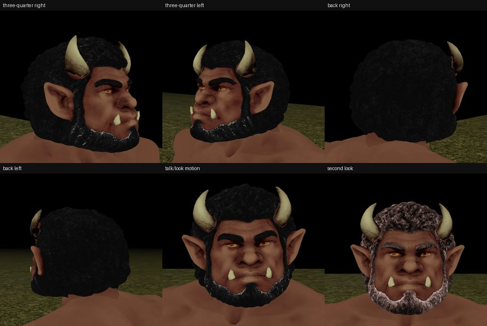
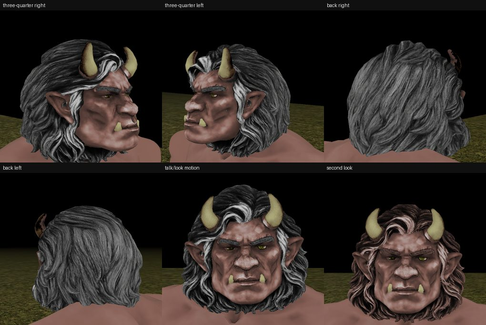
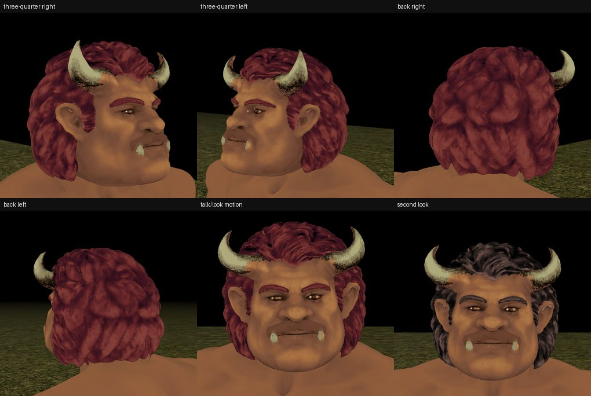
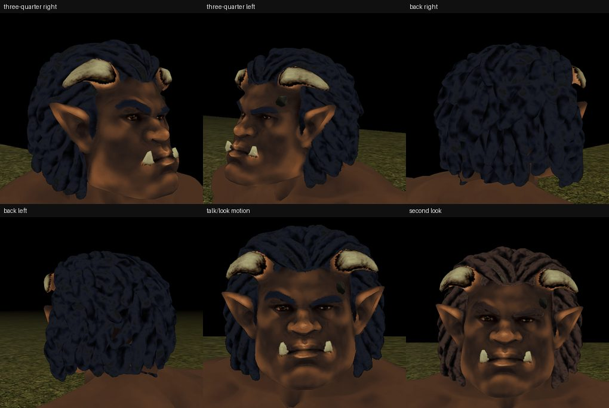
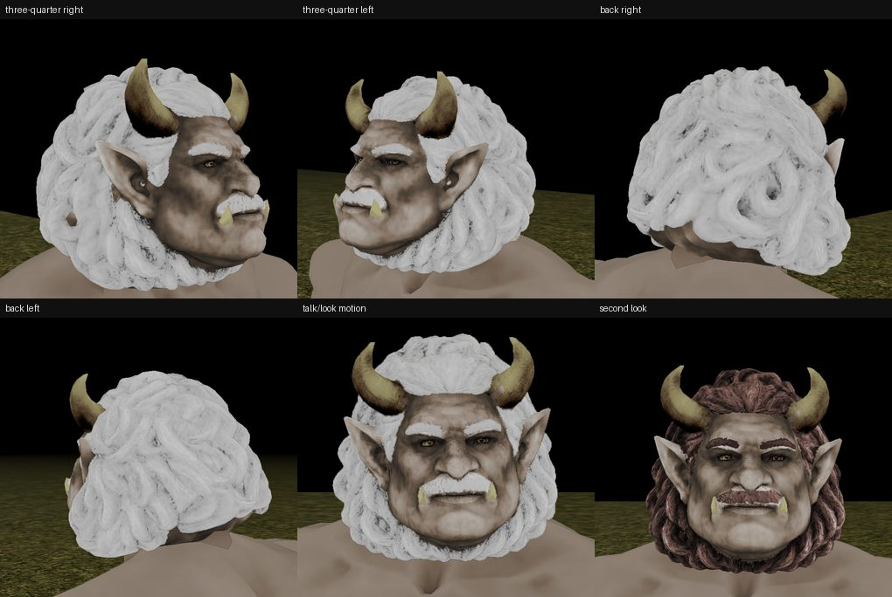
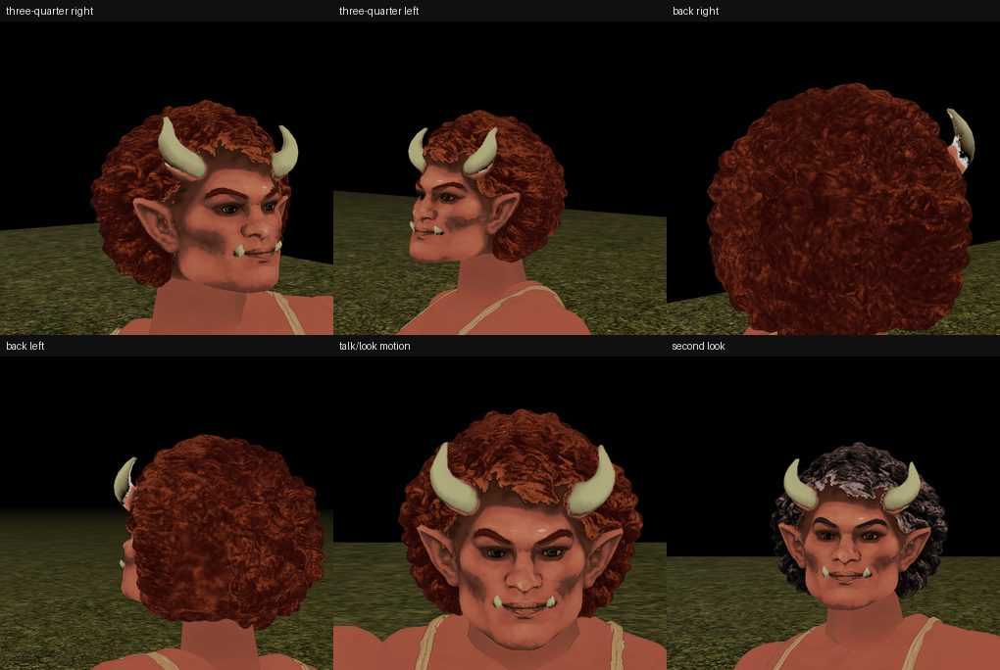
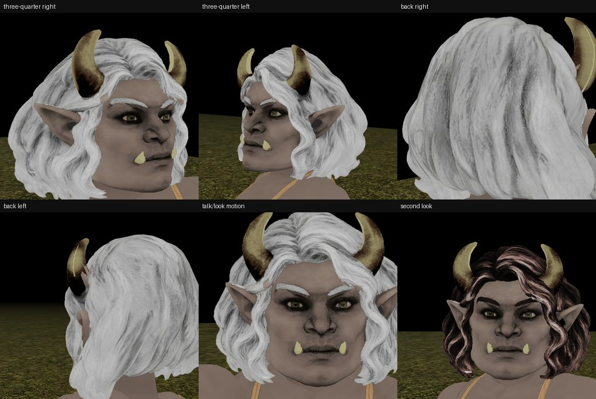
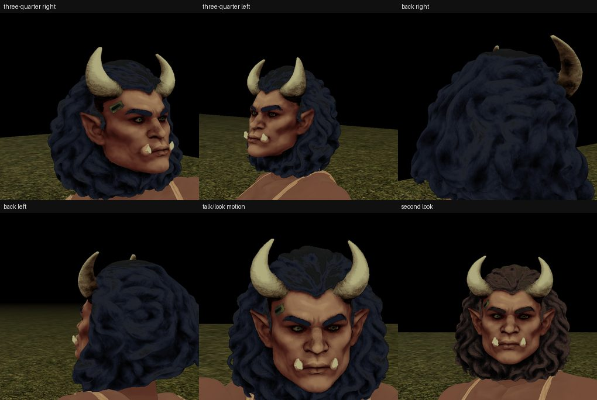
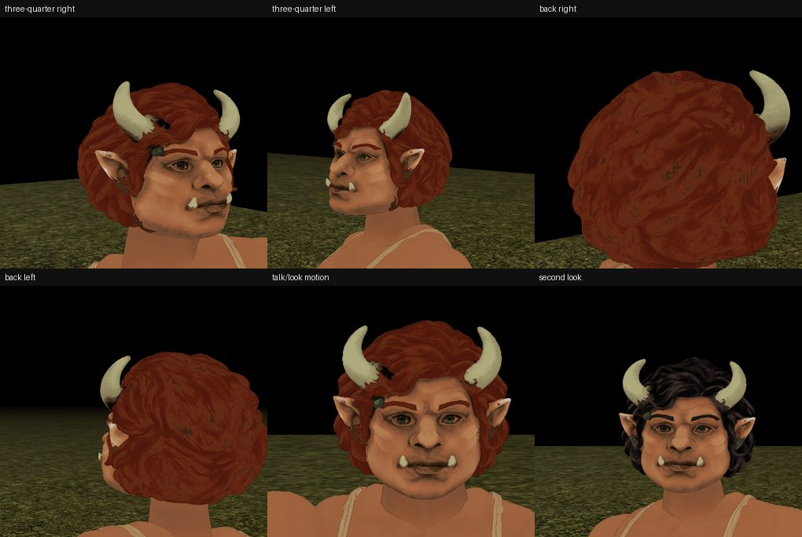
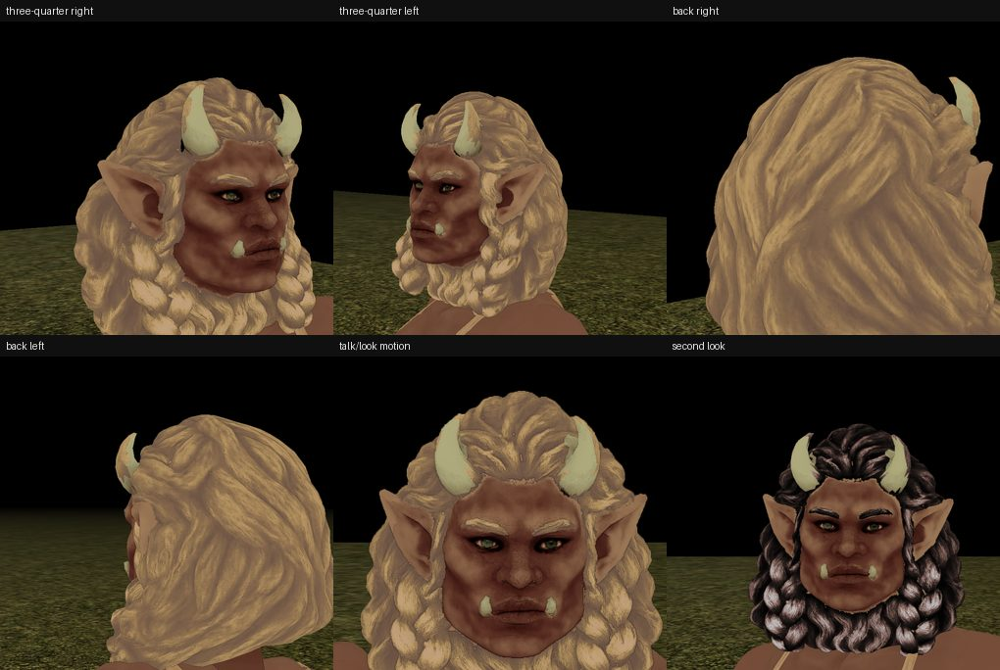

# Head library: 10 client-reviewed troll heads

This adds 10 Troll heads to `srn_head`, five male and five female. They complete the 50-head library begun by
[head-library-40-v1](head-library-40-v1.md).

| Name | Race | Slot/model | Hair | Skin / hair / iris / horn-tusk rows |
| --- | --- | --- | --- | --- |
| Anvil | Troll male | `pmg0_head021` | Dense short charcoal coils, cropped beard | 119 / 63 / 35 / 120 |
| Siltstone | Troll male | `pmg0_head022` | Salt-and-pepper jaw-length swept waves | 65 / 60 / 111 / 120 |
| Fuse | Troll male | `pmg0_head023` | Full short dark-red hair, moustache | 3 / 159 / 157 / 120 |
| Deepwell | Troll male | `pmg0_head024` | Medium blue-black natural twists | 6 / 134 / 123 / 120 |
| Moraine | Troll male | `pmg0_head025` | Long silver coils tied back behind the horns, moustache | 75 / 62 / 123 / 120 |
| Kintsilt | Troll female | `pfg0_head021` | Full short dark auburn coils | 13 / 6 / 113 / 120 |
| Basinfog | Troll female | `pfg0_head022` | Dense silver waves in a jaw-length bob | 17 / 62 / 114 / 120 |
| Duskforge | Troll female | `pfg0_head023` | Long matte indigo-black curls below the jaw | 118 / 133 / 115 / 120 |
| Oxbow | Troll female | `pfg0_head024` | Soft cropped copper waves | 2 / 4 / 115 / 120 |
| Moonquarry | Troll female | `pfg0_head025` | Long platinum curls in two broad braids | 118 / 50 / 115 / 120 |

Each head is a rigid 20,000-triangle MDL with a 1024×1024 PLT. These are the exact native bytes the private NWN:EE client
loaded in each head's final review session, taken from that session's trial HAK. The combined-pack check loaded the same
bytes. Publication reruns nothing.

Each head has its own PLT. Irises are on tattoo1. Horns and tusks are on tattoo2, row 120 ivory, so they keep their colour
when a player changes the tattoo colours. Cyberware is on metal1. Seven heads use the built-in organic head material.
Duskforge, Oxbow and Deepwell carry metal1 cyberware, so they keep the legacy material. Stock material and palette
payloads are not redistributed.

The user selected the designs and delegated operator reviews through the client in batches of five. For each head the
operator checked:

- four three-quarter views (front and back, both sides)
- a gameplay-distance view
- talk/look motion
- a second palette look

The operator then verified the logged slots and colours. Geometry approvals, the Deepwell budget and VRAM decisions and the
per-head threshold exceptions were the user's decisions. Each is quoted in that head's `reviewNotes` in the
[portable manifest](head-library-trolls-v1.json). The manifest also holds:

- resource hashes and design hashes
- submission counters
- the client session and trial HAK
- the hash of every source frame used in the galleries

## User-accepted exceptions and known limitations

- **Quality exceptions:**
  - Brows-on-hair: Anvil 0.82, Fuse 0.75, Moraine 0.79, Kintsilt 0.78 and Basinfog 0.63.
  - Fuse's muted moustache is on skin.
  - Deepwell's geometry ran at a one-job 12.7e9 Comfy VRAM cap. Its repair has a 0.51% stand-off and 4.5% fine-relief
    extent, and its UV coverage floor is 0.17.
  - The shared limits are unchanged.
- **Geometry:**
  - Anvil keeps small rear coil holes. They are not visible at the review angles.
  - Deepwell's twists leave a high repair genus. It was judged in the renders and the client.
- **Colour:**
  - Fuse and Moraine keep small specks deep in the ear canals.
  - Anvil keeps light flecks at the beard edge.
  - Fuse keeps horn-root speckles.
  - Siltstone's horns read darker from behind.
  - Basinfog's horns are gold-brown with darker roots.
  - Oxbow keeps a small dark spot at the inner root of one horn.
- **Cyberware:** metal1 shows the armour's metal colour. Without armour, the client draws stock row 0 with environment
  shine. This affects Duskforge's temple implant and the Oxbow and Deepwell datajacks.

The [combined-pack check](race-heads-v1-runbook.md) (runbook row 501) loaded all 50 library heads together:
- the 40 published heads from the production `srn_head`
- these 10 from a trial HAK above it

Every session verified, and no head swapped, lost its texture or was shadowed. Helmet combinations, every palette row,
the full animation catalogue, extended gameplay and multiplayer were not checked.

## In-game evidence

These galleries crop and reduce the original client frames; textures and geometry are not edited. Each shows four angles,
a motion frame and the second look.

## Loading

Load `srn_head` above `srn_body` and use the slots above. All 216 existing `srn_head` resources remain byte-identical. No
bodies, tables, pack registration or existing head slots change. Armorkit head envelopes are not re-measured here.
