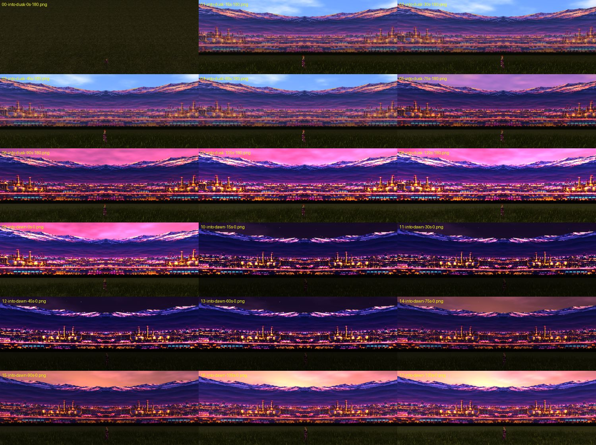

# SRN dynamic skies

A fixed land panorama over a procedural, animated sky, drawn by a custom material shader on an ordinary NWN:EE skybox
model. The land stays put; clouds drift, stars twinkle, a moon crosses, windows flicker, beacons blink and, in the
storm, lightning flashes and searchlights sweep. Dawn, day, dusk and night are the game's own sky models and fade
into each other the game's own way.

Built by `tools/skykit` (2026-11-19). Client-checked on one local client (Windows, NVIDIA RTX 3060, game build in
`D:/Program Files/GOG Galaxy/...`), one area, one session; not yet seen in SR_NWN.

## Rows

| ID | Label | Cyclical | Dawn / day / dusk / night |
|---|---|---|---|
| 16 | `SRN_Denver_Dynamic` | 1 | `srn_skyden_da` / `_d` / `_du` / `_n`: Front Range, downtown, refineries, arcology |
| 17 | `SRN_Sprawl_AcidStorm` | 0 | `srn_skystm_n` all day: megasprawl storm night, lightning, searchlights, rain |
| 18 | `SRN_Denver_Dusk_Fixed` | 0 | `srn_skyden_du` all day |
| 19 | `SRN_Denver_Night_Fixed` | 0 | `srn_skyden_n` all day |
| 20 | `SRN_Awakened_Peaks` | 1 | `srn_skypk_da` / `_d` / `_du` / `_n`: Rocky Mountain wilderness, mana aurora at night |
| 21 | `SRN_Awakened_Aurora` | 0 | `srn_skypk_n` all day |

Pick one in Area Properties or with `SetSkyBox(16, oArea)`. A fixed row keeps its look at every hour; its animation
still runs. The table is `srn_2da/skyboxes.2da`; the resources are in `srn_skybox`.


## How it works

```
skyboxes.2da row -> dawn/day/dusk/night model (srn_skyden_*.mdl, a 675 m inward sphere)
  -> its bitmap names its material (srn_skyden_*.mtr)
     -> vertex shader: the game's vsvt; fragment shader: srn_sky_fs.shd + srn_sky_math.shd
     -> texture0/1: land panorama halves (RGBA; alpha = land), texture2/3: light masks (R windows, G beacons)
     -> parameters: the phase's colours, sun, clouds, night objects, storm
  engine: worldtimerTimeOfDay, moduleMinutesPerHour, areaWeatherDensity, globalColor.a (the model fade)
```

- **Direction from texture coordinates.** The dome's u runs once round the horizon from the area's east (+x)
  counter-clockwise, v from nadir to zenith. The shader turns them into a direction; nothing depends on the
  camera.
- **The land band.** The panorama holds only the band from 2 degrees under the horizon to its top (the manifest's
  `band`), 8192 texels round in two halves. Below the band the shader paints dark blurred ground; above it, sky.
  Each half keeps continuous coordinates either side of the join so mip selection never jumps there.
- **Clouds** are a flat sheet seen in perspective, five-octave value noise, with edges facing the sun lit and thick
  middles darker. They drift in a slow circle once per game day, so midnight's clock wrap is seamless.
- **Light masks.** Windows and neon (R) dim into their surroundings by day and flicker gently at night; beacons (G)
  blink each to its own clock. The masks are found from the picture (`panorama.lights`).
- **City glow.** The masks' smallest mip gives the light of the sprawl toward each azimuth; it lights the
  undersides of low clouds in the phase's `SkyGlow` colour.
- **Weather.** `areaWeatherDensity` raises cloud cover and darkens the land. The storm material adds lightning (a
  flash round a random azimuth, sometimes a forked bolt), rain haze and streaks, and six sweeping searchlights.
- **The engine's fade** is kept exactly: `gl_FragColor = vec4(colour, globalColor.a)`. Removing it breaks the
  dawn/day/dusk/night crossfade.

## Parameters

Set in `tools/skykit/profiles.py`; the build writes them into the materials. Uniforms are documented at the top of
`srn_sky_math.shd`.

| Parameter | Meaning |
|---|---|
| `SkyPhase` | 0 dawn, 1 day, 2 dusk, 3 night (day dims windows; night shows stars, moon, aurora) |
| `SkyBand` | band bottom and top (degrees, from the build), land haze, day window dimming |
| `SkyZenith`, `SkyHorizon` | sky gradient; horizon alpha is the sunset band's sharpness |
| `SkyCloud` | cloud colour; alpha is cloud opacity |
| `SkyLand` | land tint; alpha is desaturation |
| `SkySun`, `SkySunColor` | sun azimuth, elevation, disc size and glow; colour and cloud rim light |
| `SkyMotion` | cloud drift radius, cover, storm, lightning |
| `SkyNight` | stars, moon, aurora, window light strength |
| `SkyExtra` | searchlights, beacons, city glow on clouds, rain haze |
| `SkyGlow` | colour of the city's light on clouds |

## Building

```
python -m tools.skykit build              # panoramas, DDS (vendored NWN Crunch), models, materials, fallbacks, rows
python -m unittest tools.skykit.test_skykit
python -m tools.skykit.client_fixture --nwn-root <game install>               # fixed views
python -m tools.skykit.client_fixture --nwn-root <game install> --transition  # time runs through dusk and dawn
```

Previews and fallback pictures need ModernGL with an OpenGL 3.3 context; `--no-render` skips them. Intermediate
pictures, previews and client captures go to `output/skykit/` (ignored). `docs/skies/manifest.json` records source
and resource hashes; the tests check the pack against it and the materials against the profiles.

## Client check (2026-11-19)

- All five materials draw with the custom shader; the engine log names no shader or material error.
- Letting time run (two-minute hours): day fades to dusk over about 15 to 30 seconds after 18:00, night to dawn
  after 6:00. A `SetTime` jump also fades, over several seconds.



- The sky shows only when the camera is tilted near the horizon; at a normal play pitch (about 60 degrees) the
  ground fills the screen. The band was lowered to leave more open sky in that view.
- Not checked: Linux and other GPUs, other game builds (the shader includes the game's `inc_standard`), interiors,
  multiplayer, and areas with tall tiles in front of the horizon.

## Art

Each panorama is three views of 120 degrees (`tools/skykit/art/<set>/view_*.png`, prompts beside them) and three
redrawn joins between them (`join_*.png`): `panorama.join_input` lays the ends of two neighbouring views either side
of a crossfade, the image model repaints that middle (`art/join.qwen-prompt.txt`) and `panorama.assemble` feathers the
repainted middle into both views. Denver's west view is Codex CLI image generation from the user's concept; every
other view and every join is the local Qwen-Image 2.1 profile on the shared ComfyUI (2026-11-19, the user's trial of
the local route while the Codex quota was spent), each an edit of the Denver west view so it keeps its composition.
Denver's Qwen pictures are colour-matched to the Codex view (`match`). The build flips each strip: u grows
counter-clockwise, which from inside the dome is the viewer's left.

## Known limits and next steps

- **Mixed art sources.** Qwen's views are more photographic than the Codex painting; the grade match narrows it. The
  Codex prompts of a full painted set are kept as `view_*.codex-prompt.txt` for when the quota returns.
- **Day uses dusk-lit art** for Denver, recoloured by the day material. The peaks art is neutral daylight, tinted per
  phase.
- **Fast-cycle check:** `client_fixture --play` jumps the clock an hour every 12 seconds and shows the next sky each
  day (Denver, Peaks, Storm).
