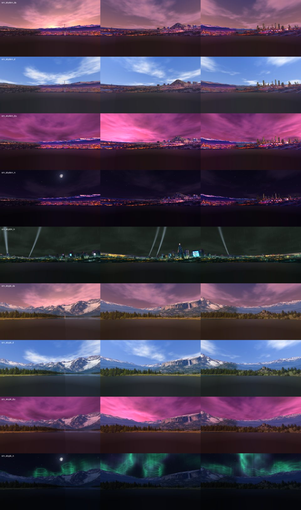

# SRN dynamic skies

A fixed land panorama over a procedural, animated sky, drawn by a custom material shader on an ordinary NWN:EE skybox
model. The land stays put; clouds drift, stars twinkle, a moon crosses, windows flicker, beacons blink and, in the
storm, lightning flashes and searchlights sweep. Dawn, day, dusk and night are the game's own sky models and fade
into each other the game's own way.

Built by `tools/skykit` (2026-11-19). Client-checked on one local client (Windows, NVIDIA RTX 3060, game build in
`D:/Program Files/GOG Galaxy/...`), one area, one session; not yet seen in SR_NWN.

## Rows

| ID | Label | Cyclical | Dawn / day / dusk / night |
|---|---|---|---|
| 16 | `SRN_Denver_Dynamic` | 1 | `srn_skyden_da` / `_d` / `_du` / `_n`: Front Range, downtown, refineries, arcology; searchlights at night |
| 17 | `SRN_Sprawl_AcidStorm` | 0 | `srn_skyden_st` all day: Denver's skyline under the acid storm, lightning, searchlights, rain |
| 18 | `SRN_Denver_Dusk_Fixed` | 0 | `srn_skyden_du` all day |
| 19 | `SRN_Denver_Night_Fixed` | 0 | `srn_skyden_n` all day |
| 20 | `SRN_Awakened_Peaks` | 1 | `srn_skypk_da` / `_d` / `_du` / `_n`: Rocky Mountain wilderness, mana aurora at night |
| 21 | `SRN_Awakened_Aurora` | 0 | `srn_skypk_n` all day |
| 22 | `SRN_Denver_Day_Fixed` | 0 | `srn_skyden_d` all day |
| 23 | `SRN_Awakened_Day_Fixed` | 0 | `srn_skypk_d` all day |

Pick one in Area Properties or with `SetSkyBox(16, oArea)`. A fixed row keeps its look at every hour; its animation
still runs. The table is `srn_2da/skyboxes.2da`; the resources are in `srn_skybox`.



## How it works

```
skyboxes.2da row -> dawn/day/dusk/night model (srn_sky*_*.mdl, a 675 m inward sphere)
  -> its bitmap names its material (srn_sky*_*.mtr)
     -> vertex shader: the game's vsvt; fragment shader: srn_sky_fs.shd + srn_sky_math.shd
     -> texture0/1: land panorama halves (RGBA; alpha = land), texture2/3: light masks (R windows, G beacons)
     -> parameters: the phase's colours, sun, clouds, night objects, storm
  engine: worldtimerTimeOfDay, moduleMinutesPerHour, areaWeatherDensity, globalColor.a (the model fade)
```

- **Direction from texture coordinates.** The dome's u runs once round the horizon from the area's east (+x)
  counter-clockwise, v from nadir to zenith. The shader turns them into a direction; nothing depends on the
  camera.
- **The land band.** The panorama holds only the band from 2 degrees under the horizon to its top (the manifest's
  `band`), 16384 texels round in two halves (512 or 1024 tall). Below the band the shader paints dark blurred ground; above it, sky.
  Each half keeps continuous coordinates either side of the join so mip selection never jumps there.
- **Clouds** are a flat sheet seen in perspective, five-octave value noise, with edges facing the sun lit and thick
  middles darker. They drift in a slow circle once per game day, so midnight's clock wrap is seamless.
- **Light masks.** Windows and neon (R) dim into their surroundings by day and flicker gently at night; beacons (G)
  blink each to its own clock. The masks are found from the picture (`panorama.lights`).
- **Relighting.** The light masks' b and a carry each face's normal (to the right and up), estimated by MoGe-2
  (`moge_2_vitl_normal_fp16`) on the shared ComfyUI in overlapping 60-degree tiles (`tools/skykit/normals.py`, cached
  by content). The sun brightens and warms faces turned toward it and shades those turned away (`SkyZenith.a`);
  lightning lights faces turned up and toward the viewer most. Masks are DXT5 for it.
- **Seams.** Every redraw is graded like the picture it continues, row by row from the overlap they share
  (`panorama.row_gain`): the image model drifts the grade of the part it keeps. Blends run over seven pyramid levels.
- **City glow.** The masks' smallest mip gives the light of the sprawl toward each azimuth; it lights the
  undersides of low clouds in the phase's `SkyGlow` colour.
- **Weather.** `areaWeatherDensity` raises cloud cover and darkens the land. The storm material adds lightning (a
  flash round a random azimuth, sometimes a forked bolt), rain haze and streaks, and sweeping searchlights.
- **Searchlights** rise from the city's rooftops in front of the land behind it, only where the light mask shows city
  at their foot. The mask leaves out the strip's top above `city_from` (Denver's sunlit snow) and red light trails
  (lines, not beacons).
- **The engine's fade** is kept exactly: `gl_FragColor = vec4(colour, globalColor.a)`. Removing it breaks the
  dawn/day/dusk/night crossfade.

## Parameters

Set in `tools/skykit/profiles.py`; the build writes them into the materials. Uniforms are documented at the top of
`srn_sky_math.shd`.

| Parameter | Meaning |
|---|---|
| `SkyPhase` | 0 dawn, 1 day, 2 dusk, 3 night (day dims windows; night shows stars, moon, aurora) |
| `SkyBand` | band bottom and top (degrees, from the build), land haze, day window dimming |
| `SkyZenith`, `SkyHorizon` | sky gradient; zenith alpha is how strongly the sun relights the land's faces, horizon alpha the sunset band's sharpness |
| `SkyCloud` | cloud colour; alpha is cloud opacity |
| `SkyLand` | land tint; alpha is desaturation |
| `SkySun`, `SkySunColor` | sun azimuth, elevation, disc size and glow; colour and cloud rim light |
| `SkyMotion` | cloud drift radius, cover, storm, lightning |
| `SkyNight` | stars, moon, aurora, window light strength |
| `SkyExtra` | searchlights, beacons, city glow on clouds, rain haze |
| `SkyGlow` | colour of the city's light on clouds; alpha is the searchlights' foot (the city's rooftops, measured by the build from the light mask) |

## Building

```
python -m tools.skykit build              # panoramas, DDS (vendored NWN Crunch), models, materials, fallbacks, rows
python -m unittest tools.skykit.test_skykit
python -m tools.skykit.client_fixture --nwn-root <game install>               # fixed views
python -m tools.skykit.client_fixture --nwn-root <game install> --transition  # time runs through dusk and dawn
python -m tools.skykit.client_fixture --nwn-root <game install> --live 8       # the game's clock at 8 min/hour; chat /sky, /time, /rain, /clear
```

A panorama without detail tiles is upscaled 2x with RealESRGAN (`RealESRGAN_x2plus.pth`) on the shared ComfyUI before keying
(`tools/skykit/upscale.py`, its HTTP API only; `SRN_COMFY_URL` overrides the address). The result is cached in
`output/skykit/<key>/x2-<hash>.png` by input and model, so a rebuild of unchanged art needs no GPU; `--no-upscale`
builds at the source size. The manifest names the model and cache file.

Both skylines have a detail pass instead: `python -m tools.skykit.detail den` (or `pk`) redraws the assembled land in
overlapping
close-ups (Denver 14, Peaks 10) with the local Qwen-Image 2.1 edit profile (`art/<set>/detail.qwen-prompt.txt`), each the land's full height and
about 1248 x 832 at the model, so windows, roofs and ridges get real detail rather than sharpened edges. The tiles are
tracked art (`art/<set>/detail/`, with `detail.json` naming the input they were drawn from); the build holds each to
its input's grade, cuts between neighbours where they agree and blends band by band, giving Denver's strip at about 2.8 times
its source size and the Peaks' at 2.

Previews and fallback pictures need ModernGL with an OpenGL 3.3 context; `--no-render` skips them. Intermediate
pictures, previews and client captures go to `output/skykit/` (ignored). `docs/skies/manifest.json` records source
and resource hashes; the tests check the pack against it and the materials against the profiles.

## Client check (2026-11-19)

- All five materials of that first build draw with the custom shader; the engine log names no shader or material
  error. The pack now has nine; all of them appear in the later `--play` cycle (rows 16, 17 and 20).
- The day-only rows 22 and 23, shot at 23:00 by the client fixture, keep their day skies. A fixed row sets only the
  sky: the area's own lighting still follows the clock, so a day sky over a night area sits above dark ground.
- Letting time run (two-minute hours): day fades to dusk over about 15 to 30 seconds after 18:00, night to dawn
  after 6:00. A `SetTime` jump also fades, over several seconds.


- The sky shows only when the camera is tilted near the horizon; at a normal play pitch (about 60 degrees) the
  ground fills the screen. The band was lowered to leave more open sky in that view.
- Not checked: Linux and other GPUs, other game builds (the shader includes the game's `inc_standard`), interiors,
  multiplayer, and areas with tall tiles in front of the horizon.

## Art

- `den`, Denver, is grown from one start view, `art/denver/view_w.png` (Codex CLI image generation from the user's
  concept). `panorama.extend_input` puts the strip's last 500 columns beside a blurred mirror of them, the image model
  repaints the placeholder (`ext_<n>.qwen-prompt.txt`) and `panorama.chain` adds it along a cut and a band-by-band
  blend; four extensions (refinery, chemical plant and rail yard, the arcology on the plains, the southern sprawl)
  and a closing join (`join_close.png`) go round, so every piece keeps the start's scale and horizon. The views drawn
  apart, used before, did not line up (user, 2026-11-19). Hazy hills under a green-keyed silhouette are cleared of
  key tint (`panorama.EDGE_ROWS`).
- `pk`, the Awakened peaks: three views of 120 degrees (`art/<set>/view_*.png`) and three
  redrawn joins between them (`join_*.png`) from `panorama.join_input`. `panorama.assemble` switches from view to join
  and back along a minimum-cost cut through each overlap (`seam_path`, image quilting) and blends across it band by
  band (`multiband`). The peaks view a to b join was redrawn a second time (2026-11-19): the first repaint had kept
  part of the crossfade.

Every picture but Denver's start view is the local Qwen-Image 2.1 profile on the shared ComfyUI (2026-11-19, the user's
trial of the local route while the Codex quota was spent); the peaks views are edits of Denver's start view. The build flips each strip: u grows counter-clockwise, which from inside the dome is the viewer's left.

## Known limits and next steps

- **Photographic art.** Qwen's views are photographic rather than painted. The Codex prompts of a full painted set
  are kept as `view_*.codex-prompt.txt` for when the quota returns.
- **Day uses dusk- and night-lit city art**, recoloured by the day material, which also dims the windows into their
  surroundings. The peaks art is neutral daylight, tinted per phase.
- **Fast-cycle check:** `client_fixture --play` jumps the clock an hour every 2.5 seconds (a day a minute) and shows the next sky each
  day (Denver, the acid storm, Peaks).
